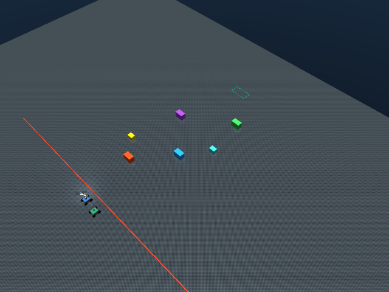
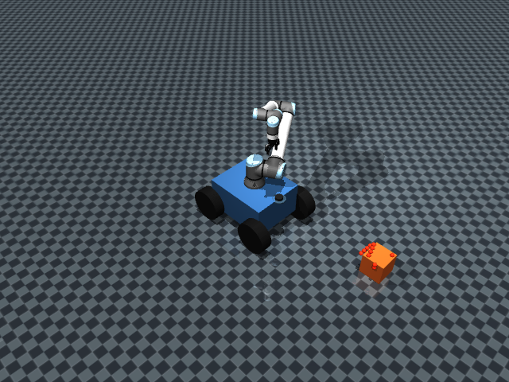
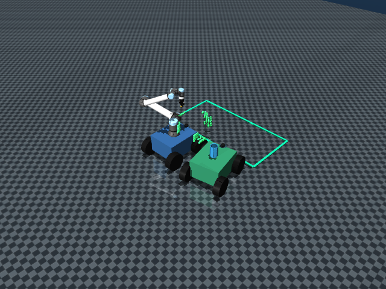
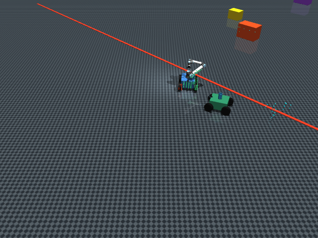

# 双车协同核应急移动操作臂仿真

[GitHub 仓库](https://github.com/binbinyoulile/Nuclear-Emergency-Mobile-Manipulator)

基于 MuJoCo 的双车协同核废料回收项目：UR10e 移动操作臂负责雷达避障、D435i 深度相机识别、抓取与投放；运输车负责动态停靠和屏蔽桶转运。项目以纯 Python 状态机实现，并保留清晰的 ROS2 / 真机迁移接口。

## 效果展示

| 长距离场景总览 | 一号车雷达避障 |
| --- | --- |
|  |  |

| 双车协同抓取 | 两车精准返航 |
| --- | --- |
|  |  |

## 核心能力

- **双车协同**：共享 `CarController` 底盘控制，实现差速运动、平滑加减速、雷达局部避障和动态停靠。
- **D435i 视觉**：离屏渲染 RGB/深度图，通过 HSV 分割、5x5 深度中位数和相机内外参变换得到世界坐标。
- **机器人操作**：UR10e + Robotiq 2F-85，使用 mink IK 完成平躺圆柱中段侧向抓取与桶内投放。
- **任务闭环**：起点出发、长距离避障、并行调度、抓取投放、倒车脱离辐射区、正向精准返航。
- **迁移友好**：视觉的数据获取与坐标变换层、底盘和机械臂控制层均有明确接口，便于替换为 ROS2 话题和 TF2。

## 环境要求

- Python 3.10+
- Windows、Linux 或 macOS
- 支持 OpenGL 的运行环境（实时预览需要）
- 当前基准环境：Python 3.13.12、`mujoco 3.16.0`、`mink 1.3.0`、`opencv-python 5.0.0.93`、`numpy 2.5.4`、`scipy 1.18.1`

## 快速开始

### Windows PowerShell

```powershell
powershell -ExecutionPolicy Bypass -File .\setup.ps1
.\.venv\Scripts\python.exe scripts\fetch_models.py
.\.venv\Scripts\python.exe .\dual_car_pick_place.py --seed 7
```

### Linux / macOS

```bash
bash setup.sh
source .venv/bin/activate
python scripts/fetch_models.py
python dual_car_pick_place.py --seed 7
```

无窗口验收并更新核心截图：

```powershell
.\.venv\Scripts\python.exe .\dual_car_pick_place.py --snapshot --seed 7
```

`setup.sh` / `setup.ps1` 只创建项目内 `.venv`，不会使用 `--system-site-packages`。脚本运行结束后会提示模型资产下载命令。

## 模型资产

MuJoCo 网格文件体积较大，因此 `models/**/assets/`、`*.obj` 和 `*.stl` 已加入 `.gitignore`。仓库保留必要的 MJCF、许可证和说明文件；新环境执行：

```powershell
python scripts\fetch_models.py
```

脚本从 [MuJoCo Menagerie](https://github.com/google-deepmind/mujoco_menagerie) 获取：

- [Universal Robots UR10e](https://github.com/google-deepmind/mujoco_menagerie/tree/main/universal_robots_ur10e)
- [Robotiq 2F-85](https://github.com/google-deepmind/mujoco_menagerie/tree/main/robotiq_2f85)

自建的 `dual_mobile_ur10e.xml` 将 UR10e、2F-85、移动底盘和 D435i 安装关系组合在同一 MuJoCo 层级中。

## 工程结构

```text
mobile_manipulator/
├── dual_car_pick_place.py   # 双车任务状态机、雷达避障、视觉与协同投放
├── mobile_pick_place.py     # 共享底盘、IK、夹爪与仿真运动底层
├── dual_car_scene.xml       # 双车主场景
├── arm_ik_scene.xml         # 机械臂 IK 辅助场景
├── models/                  # 自建 MJCF；二进制 mesh 由脚本下载
├── scripts/fetch_models.py  # Menagerie 资产下载脚本
├── docs/screenshots/        # 4 张核心展示截图
├── requirements.txt
├── setup.ps1
└── setup.sh
```

## 任务流程

1. 两车从红线后方的固定起点出发。
2. 一号车通过雷达局部避障前往目标区，二号车在收到一号车停稳坐标后并行出发。
3. 一号车用 D435i RGB/深度图识别黄色放射源，并打印像素、深度、视觉坐标和真值误差。
4. UR10e 从中段侧面抓取圆柱，二号车动态停靠到绿框外。
5. 一号车将圆柱投入二号车屏蔽桶，随后两车倒车脱离辐射区并正向精准返航。
6. 终态检查：物体在桶内、两车回到起点、车车物理接触数为 0。

## 视觉四层架构

1. `get_camera_data()`：MuJoCo `Renderer` 采集 RGB/depth；ROS2 中替换为 D435i 图像话题订阅。
2. `detect_yellow_target()`：HSV 阈值、形态学去噪、最大轮廓质心。
3. `pixel_to_world()`：深度中位数、针孔相机反投影和 `cam_xpos/cam_xmat` 外参变换；ROS2 中使用 `tf2_ros`。
4. 任务状态机：仅使用视觉返回坐标执行抓取，真实物体坐标只用于误差验证。

## 验证基线

`--snapshot --seed 7` 的基准结果：

- D435i 视觉坐标误差：约 `9.03 mm`
- 圆柱最终桶内 XY 误差：约 `0.0142 m`
- 两车物理接触：`0`
- 回起点误差：CAR1 约 `0.086 m`，CAR2 约 `0.099 m`

## 跨平台路径

脚本统一以 `Path(__file__).resolve().parent` 定位项目文件。MuJoCo 加载前会临时切换到场景目录并使用相对文件名，规避 Windows 中文绝对路径兼容问题，同时保持 Linux 路径可用。

## License

UR10e 模型文件遵循 MuJoCo Menagerie 中附带的 BSD-3-Clause License；Robotiq 2F-85 资产按其上游许可证使用。项目自建代码与场景用于学习、科研和作品展示。
