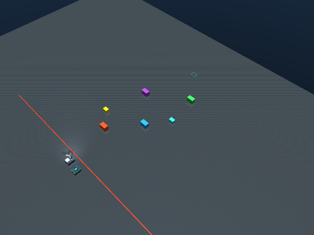
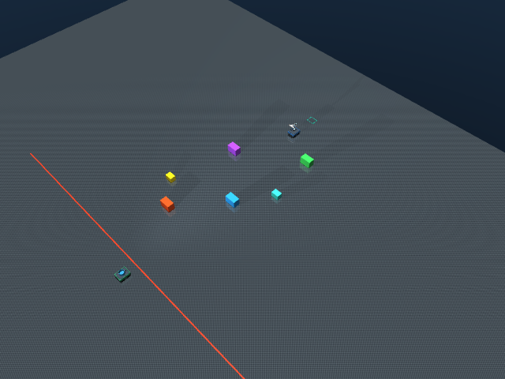
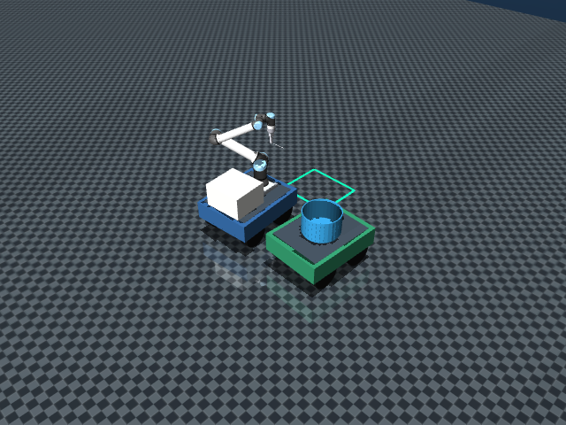
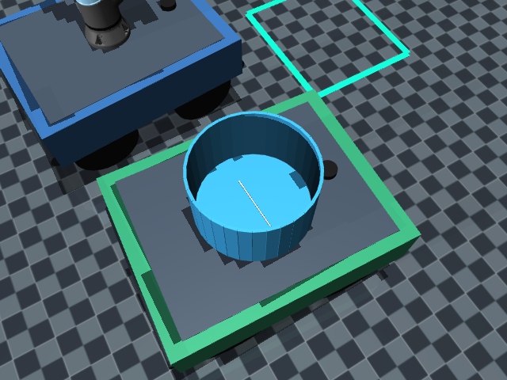
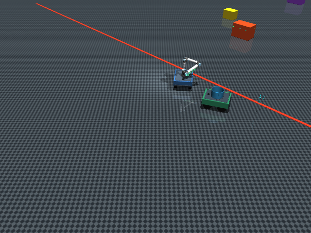

<div align="center">


</div>

# 双车协同核应急移动操作臂仿真

[GitHub 仓库](https://github.com/binbinyoulile/Nuclear-Emergency-Mobile-Manipulator) ·
[架构说明](ARCHITECTURE.md)

基于 MuJoCo 的双车协同核废料回收项目：UR10 移动操作臂（实车装 OnRobot RG2 夹爪）负责雷达避障、D435i 深度相机识别、抓取与投放；运输车负责动态停靠和屏蔽桶转运。项目以纯 Python 状态机实现，并保留清晰的 ROS2 / 真机迁移接口。

## 效果展示

| 长距离场景总览 | 一号车雷达避障 |
| --- | --- |
|  |  |

| 双车协同抓取 | 投放：监测棒落进屏蔽桶 | 两车精准返航 |
| --- | --- | --- |
|  |  |  |

## 核心能力

- **双车协同**：共享 `CarController` 底盘控制，实现差速运动、平滑加减速、雷达局部避障和动态停靠。
- **D435i 视觉**：离屏渲染深度图，先最小二乘拟合地面平面，再取"离地 0.8~30 mm"的点云做连通域与 PCA 轴线拟合，最后按两端上表面高差判定粗端并反投影出世界坐标；不依赖颜色、不读真值。
- **机器人操作**：UR10 + OnRobot RG2（实车配置），使用 mink IK 抓住不锈钢监测棒的粗端，抬起搬运后把质心对准屏蔽桶中心、在桶口上方松爪，靠自由落体落进桶底。
- **任务闭环**：起点出发、长距离避障、并行调度、抓取投放、倒车脱离辐射区、正向精准返航。
- **单一任务实现**：七阶段状态机、三个路径控制器与抓取/投放编排只在 `mission_core.py` 里写一份，
  单进程仿真与 ROS 2 任务节点共用；`mission_core` 不 import `mujoco`，硬件访问全部经由
  `robot_interface.py` 的端口（Clock / Lidar / Chassis / Arm / Gripper / Perception）。
- **迁移友好**：视觉的数据获取与坐标变换层、底盘和机械臂控制层均有明确接口，便于替换为 ROS2 话题和 TF2。

## 底盘模型

两辆车按企业真实重载底盘参数建模（默认场景 `dual_car_scene_rg2.xml` → `models/universal_robots_ur10e/dual_mobile_ur10_rg2.xml`）：

| 参数 | 数值 |
|---|---:|
| 整车质量（底盘 + 四轮） | `75 kg`（车体 `65 kg` + 四轮 `10 kg`） |
| 外形尺寸 长×宽×高 | `0.912 × 0.710 × 0.410 m` |
| 离地间隙 | `0.11 m` |
| 轴距 | `0.50 m`（前轮 X=`+0.25`，后轮 X=`-0.25`） |
| 轮距 | `0.555 m`（左轮 Y=`+0.2775`，右轮 Y=`-0.2775`） |
| 轮径 | `0.305 m`（轮心 Z=`0.1525`） |
| 顶面（机械臂/雷达安装板） | `z = 0.40356` |

- 物理碰撞体是一个按真实包络定位的 Box（车体 `65 kg`），四轮按真实轴距/轮距布置，各 `2.5 kg`。
- 纯外观件（车身外壳、前后防撞管、顶部安装板、雷达托盘）全部 `contype="0" conaffinity="0"`、`mass="0"`，不参与物理。
- 已知偏差：参数表标注"四轮差速转向"，但控制器运动学使用前轮转向角；去掉转向节后实测原地转仅 `0.13 rad/s` 且车体滑移 `0.3 m`，任务定位精度不足，因此暂保留前轮转向节作为等效机构，待控制器改为纯差速转向后再移除。
- 机械臂模型（UR10 `32.4 kg` + OnRobot RG2 `0.8 kg`）因此一号车整机仿真质量 `108.2 kg`
  （真实 75 kg 底盘 + 机械臂与夹爪）；二号车含 Ø400 屏蔽桶（`3.0 kg`）共 `78.0 kg`。
  注：实车另外装有约 25 kg 的控制箱、且机械臂安装位置偏车头一侧，这两项**尚未**进模型
  （等厂家尺寸），所以仿真的整车质心与实车仍有差异。

## 被操作对象与屏蔽桶

放射源按真实不锈钢监测棒建模（默认场景 `dual_car_scene_rg2.xml` 的 `grasp_object`）：

| 参数 | 数值 |
|---|---:|
| 粗端 / 细端 | `Ø6 mm × 33 mm` / `Ø5 mm × 169 mm` |
| 总长 | `202 mm` |
| 材料 | 不锈钢 `7930 kg/m³`，整件 `33.5 g`，质心距粗端 `95 mm`（距 body 原点 `79 mm`，由模型惯性参数直接读出） |
| 外观 | 端面 0.25 mm 倒角网格（`models/chopstick/chopstick.obj`），银灰高光 |
| 碰撞体 | 两段标准圆柱（长度各缩 0.3 mm 代表倒角），`condim=6`，滚动摩擦 `0.03` |

- 物体原点放在**粗端圆柱中心**：真值点、视觉输出的粗端点、抓取点三者天然重合。
- 二号车屏蔽桶是 32 边圆筒（内径 `Ø400 mm`、内深 `240 mm`、外高 `260 mm`、底厚 `20 mm`）。桶口比监测棒长得多，可容忍桶心偏差约 `98 mm`（Ø240 时只有 `18 mm`），真机定位误差才吃得下；
  夹住粗端的机械臂把质心对准桶心后松爪，监测棒整根自由落进桶底。
- 为什么桶口必须大于杆长：刚性杆只能从"开口 ≥ 杆长"或"倾斜着"进入更窄的洞。实测 `Ø100` / `Ø130`
  桶口时，水平杆必然横架在桶沿上；把夹持力从 `5.1 N` 提到 `48.4 N` 也压不进去（杆变成刚性探针、
  机械臂直接压不动），夹持力小时杆反而被桶沿顶出夹爪。另：二指夹爪夹住杆后无法施加俯仰力矩
  （在 2F-85 上实测：工具下俯 58°、杆纹丝不动；RG2 同为二指夹爪，结论相同），所以杆只能水平搬运。

## 环境要求

- Python 3.10+
- Windows、Linux 或 macOS
- 支持 OpenGL 的运行环境（实时预览需要）
- 当前基准环境：Python 3.13.12、`mujoco 3.16.0`、`mink 1.3.0`、`opencv-python 5.0.0.93`、`numpy 2.5.4`、`scipy 1.18.1`

## 快速开始

### Windows PowerShell

```powershell
powershell -ExecutionPolicy Bypass -File .\setup.ps1
.\.venv\Scripts\python.exe scripts\fetch_models.py
.\.venv\Scripts\python.exe .\dual_car_pick_place.py --seed 7
```

### Linux / macOS

```bash
bash setup.sh
source .venv/bin/activate
python scripts/fetch_models.py
python dual_car_pick_place.py --seed 7
```

无窗口验收并更新核心截图：

```powershell
.\.venv\Scripts\python.exe .\dual_car_pick_place.py --snapshot --seed 7
```

`setup.sh` / `setup.ps1` 只创建项目内 `.venv`，不会使用 `--system-site-packages`。脚本运行结束后会提示模型资产下载命令。

## 模型资产

MuJoCo 网格文件体积较大，因此 `models/**/assets/`、`*.obj` 和 `*.stl` 已加入 `.gitignore`（本项目自己生成的 `models/chopstick/chopstick.obj` 有例外，随仓库入库）。仓库保留必要的 MJCF、许可证和说明文件；新环境执行：

```powershell
python scripts\fetch_models.py
```

脚本从 [MuJoCo Menagerie](https://github.com/google-deepmind/mujoco_menagerie) 获取：

- [Universal Robots UR10e](https://github.com/google-deepmind/mujoco_menagerie/tree/main/universal_robots_ur10e)（UR10 与 UR10e 几何完全一致，共用这套网格）
- [Robotiq 2F-85](https://github.com/google-deepmind/mujoco_menagerie/tree/main/robotiq_2f85)（旧模型备查）
- OnRobot RG2 本体视觉网格（`rg2_body.stl`，来自 [ikalevatykh/onrobot_ros](https://github.com/ikalevatykh/onrobot_ros) 的 `visual/body.stl`，MIT）。手指仍用基本几何体——那套 URDF 是四连杆，与本模型的平移简化不是一套运动学

自建的两份整车装配是 `models/universal_robots_ur10e/dual_mobile_ur10_rg2.xml`（默认，UR10 + RG2）
与 `dual_mobile_ur10e.xml`（旧配置，UR10e + 2F-85），把机械臂、移动底盘和 D435i 的安装关系组合在同一 MuJoCo 层级中。

## 工程结构

```text
mobile_manipulator/
├── mission_core.py          # 任务层：七阶段状态机 + 三个路径控制器 + 抓取/投放编排（零 MuJoCo）
├── dual_car_pick_place.py   # 单进程入口：Sim* 适配器、场景初始化、深度视觉、截图与指标
├── mobile_pick_place.py     # MuJoCo 底层：MJCF 加载、mink IK、重力补偿、仿真步进
├── robot_interface.py       # 硬件端口抽象：Clock / Lidar / Chassis / Arm / Gripper / Perception
├── dual_car_scene_rg2.xml   # 双车主场景（默认：UR10 + OnRobot RG2）
├── dual_car_scene.xml       # 旧配置场景（UR10e + 2F-85，保留备查）
├── arm_ik_scene.xml         # 机械臂 IK 辅助场景
├── models/                  # 自建 MJCF 与监测棒网格；Menagerie 二进制 mesh 由脚本下载
├── scripts/fetch_models.py  # Menagerie 资产下载脚本
├── scripts/run_matrix.py    # 多 seed 回归矩阵（CSV + 每 seed 日志）
├── scripts/compare_metrics.py  # 两份回归 CSV 逐指标对比
├── scripts/check_ports.py   # 两个后端是否都实现了全部端口（漏方法在构造时即报错）
├── scripts/check_rg2_model.py  # RG2 模型自检：关节行程、稳态夹持力、夹持后滑移
├── scripts/run_ros_matrix.py  # 轨道 B（ROS 多 seed）并行回归，CSV 与轨道 A 同构
├── scripts/bench_chassis.py   # 架空台架：量轮径/轮距/死区/左右一致性（真车第一件事）
├── scripts/check_lidar_geometry.py  # 雷达摘要的几何自检（扇区边界、地面门限等 20 个用例）
├── reports/                 # regression.csv（入库）、baselines/ 历史基线、logs/（本地忽略）
├── ros2_ws/src/             # ROS 2 六包：mm_msgs / mm_sim / mm_mission / mm_perception / mm_base / mm_bringup
├── docs/screenshots/        # 5 张核心展示截图
├── docs/ros2_stage1_design.md  # 阶段 1 节点/话题/消息设计
├── requirements.txt
├── setup.ps1
└── setup.sh
```

## 任务流程

1. 两车从红线后方的固定起点出发。
2. 一号车通过雷达局部避障前往目标区，二号车在收到一号车停稳坐标后并行出发。
3. 一号车用 D435i 深度图识别不锈钢放射源：观测位先粗定位，再开到 1.41 m 测量位精定位，
   打印像素、深度、视觉坐标和真值误差。
4. UR10 + RG2 自上而下抓住监测棒的**粗端**（离地夹持点高度按 RG2 指垫实测几何取 15.5 mm），二号车动态停靠到绿框外：全程纯追踪平滑转弯入位，
   到点**完全不原地转**——差速原地转在地面上是轮胎打滑，只为补正几度就会把车整体
   滑移 2 cm，而且正好发生在机械臂准备投放、车身必须绝对静止的时刻。
   停靠点 Y 预留 0.06 m 车身投影余量，任何朝向下都越不过绿框边界。
   一号车抓取前同理：只有残余偏航超过 12° 才原地摆正，实测 21 个种子残差都在
   0.1°~9.2°，全部直接留着不动车。
5. 一号车把监测棒送到二号车屏蔽桶口：先按实测杆轴把质心对到桶心，再在桶口上方 6 cm
   松爪，监测棒整根自由落体落进桶底；随后两车倒车脱离辐射区并正向精准返航。
6. 终态检查：物体在桶内、两车回到起点、车车物理接触数为 0。

目标区按 UR10 工作空间收紧为 `0.70 × 0.60 m`（X `±0.35`，Y `20.70 ~ 21.30`），
`mission_core.py` 的 `TARGET_ZONE_*` 常量与 `dual_car_scene_rg2.xml` 的四个绿色边框
geom 一一对应，改一处必须同步另一处。

监测棒长 202 mm、body 原点在粗端截面中心、生成时沿世界 `+X` 平放，所以采样不是在框内
均匀取原点，而是**按整根杆的占地范围收缩**：搜索窗（`±0.30 m`）减去两端半长（粗端
`16.2 mm`、细端 `185.2 mm`）再留 `15 mm` 余量，得到 `OBJECT_X_RANGE = -0.269 ~ +0.100`、
`OBJECT_Y_RANGE = 20.78 ~ 21.22`。区间由杆的几何自动推出，杆一改长就直接失效报错，
不会静默生成"两头戳出绿框"的非法用例——这类用例会让相机拍不全、臂展够不到，
反映出的是测试用例不合理，而不是控制或视觉算法的缺陷。

## 视觉四层架构

1. `get_camera_data()`：MuJoCo `Renderer` 采集 RGB/depth；ROS2 中替换为 D435i 图像话题订阅。
2. `depth_to_world()`：整幅深度图反投影成世界点云（`fx=fy=(H/2)/tan(fovy/2)`，相机 +Z 与视线反向，深度取负）。
3. `detect_steel_target()`：点云先最小二乘拟合地面平面，取离地 0.8~30 mm 的点，连通域只保留与搜索区相交者，
   二维 PCA 求轴线、1%/99% 分位定两端，再比较两端外侧 20% 的上表面高度（Ø6 粗端的顶面比 Ø5 细端高 1 mm）判定粗端。
4. 任务状态机：仅使用视觉返回坐标执行抓取，真实物体坐标只用于误差验证。

为什么不用颜色：不锈钢本色在中性灰地面上没有色差。为什么不能拿单帧深度当绝对高度：渲染器深度带约 0.15% 的系统性尺度偏差，
2 m 外的地面会"高出" 1.5 mm，必须先用地平面拟合把它吸收掉。

## 多 seed 回归与验证基线

单次成功不能说明可靠性，因此每次改动后跑同一组种子：

```powershell
.\.venv\Scripts\python.exe .\scripts\run_matrix.py --seeds 0-20 --jobs 6
```

脚本起 `--headless` 子进程（不覆写截图），单种子超时保护，把指标写入
`reports/regression.csv`、每个种子的完整日志写入 `reports/logs/seed_<n>.log`。
任务本身在成功/失败时都会打印一行 `RESULT_JSON:` 并以退出码 `0`/`1` 结束，
失败时 `stage` 字段直接指出卡在哪个阶段。

`--jobs` 并行只改墙钟、不改结果：每个种子是独立进程与独立物理，同一份代码在串行与多路
并行下跑同一种子，指标逐位一致（`compare_metrics --tol 1e-9`）。单种子墙钟 `62 ~ 65 s`
（3~5 路并行时），21 个种子约 `6 ~ 10 min`，串行约 `23 min`。

### 当前结果：UR10 + OnRobot RG2（实车配置，2026-11-23）

老师确认实车是 UR10 + OnRobot RG2，因此默认场景换成这一套，UR10e + 2F-85 原样保留备查。
同一组 `seed 0–20`、同一速度档下的结果：

- 通过率：`21/21`
- D435i 视觉坐标误差：`0.88 ~ 3.47 mm`
- 落桶判据（几何包含）：`21/21`，投放后杆底 `0.432 ~ 0.466 m`（桶底 `0.424 m`）、
  杆顶均低于桶沿 `0.664 m`
- 投放后姿态：杆与**竖直方向**的夹角 `76.9 ~ 87.5°`（`90°` 即完全横躺；2F-85 那套是
  `47.0 ~ 50.4°`，反而更接近立着）。Ø400 桶口在横躺姿态下可容忍桶心偏差约 `88 mm`，
  而实测质心水平偏差只有 `0.7 ~ 4.5 mm`，余量充足
- 投放质心水平偏差：`0.7 ~ 4.5 mm`；返航后仍在桶内：`21/21`
- 停靠时全程最小中心距：`0.978 ~ 1.060 m`，物理接触 `0`
- 回起点误差：CAR1 `0.081 ~ 0.087 m`，CAR2 `0.082 ~ 0.096 m`
- 单次仿真时长：`120.0 ~ 121.2 s`
- 原始指标：`reports/baselines/ur10_rg2_0p8_bucket400.csv`
  （杆底、杆顶、口内余量只在单进程日志里逐种子打印，CSV 不含这几列）

**轨道 B（ROS 2 分布式，同一批种子）在换装后也重跑并冻结：`21/21`**，
`reports/baselines/ros_track_b_ur10_rg2.csv` —— 视觉 `0.82 ~ 6.01 mm`、投放 xy
`1 ~ 10 mm`、投放后与竖直夹角 `80.0 ~ 88.0°`、返航后仍在桶内 `21/21`、接触 `0`、
回起点 CAR1 `0.072 ~ 0.085 m` / CAR2 `0.083 ~ 0.097 m`、单次仿真 `121.3 ~ 124.5 s`、
并行 4 路墙钟 28.9 min。

换装时踩到的五个"不报错、只表现为行为不对"的问题（指杆碰撞体比指尖长 61 mm、
工具自旋候选要按新夹爪的开合轴重算、`<general>` 少了 `biastype="affine"` 导致夹爪
根本不合拢、指关节需要显式硬限位、位置伺服要饱和到 40 N 才夹得住 Ø6 杆），以及
轨道 B 独有的三处（ROS 侧默认场景还指向 2F-85、夹爪指令初值 0 被钳成全闭、
抓取高度带贴得太薄）都记录在 `docs/ur10_rg2_switch.md`。

### 旧配置结果：UR10e + 2F-85（2026-11-21，已归档，不与上面的数据混比）

`seed 0–20`（21 个），不锈钢监测棒 + Ø400 屏蔽桶，`0.8 / 0.5 / 0.3 m/s` 速度档：

- 通过率：`21/21`
- D435i 视觉坐标误差：`0.53 ~ 2.18 mm`
- 落桶判据（几何包含）：整根杆都在桶口投影内 —— `21/21`，端点离桶壁余量 `100 ~ 110 mm`
  （投放瞬间口内余量 `109 ~ 117 mm`），杆顶高度 `0.557 ~ 0.566 m`（桶沿 `0.664 m`）
- 桶内质心水平偏移：`0.006 ~ 0.013 m`（记录量，作横向精度参考，不参与判定）
- 投放后姿态：杆与竖直方向夹角 `47.0 ~ 50.4°`（整根落进桶内，不立起、不架在桶沿）
- 返航后物体仍在桶内：`21/21`（按同一条几何判据在返航终点复测）
- 停靠时刻两车中心距：安全阈值 `0.82 m`，全程最小中心距 `0.969 ~ 1.048 m`，物理接触 `0`
- 回起点误差：CAR1 `0.082 ~ 0.088 m`，CAR2 `0.091 ~ 0.097 m`（阈值 `0.20 m`）
- 单次仿真时长：`119.8 ~ 121.0 s`（真车速度口径，见「已知限制」；2.0 m/s 旧档为 `69.4 ~ 70.9 s`）
- 原始指标：`reports/baselines/speed_0p8_bucket400.csv`（21 行；Ø240 旧档 `speed_0p8.csv` 保留备查）


回归矩阵覆盖的是"随机落点 + 固定流程"，随机区间本身就是用例的一部分：202 mm 的杆一旦
戳出视觉搜索窗，观测位就拍不全、粗端判错约一个杆长；更极端的落点还会让车停在相机下视场
之外、机械臂够不到。这类失败反映的是用例不合理而非算法缺陷，因此采样区间按杆的两端半长
从搜索窗内缩（见上文"被操作对象与屏蔽桶"），21 个种子生成的杆全部完整落在窗内。

历史基线快照保存在 `reports/baselines/`：`v1.0.0.csv`（旧 Ø20 mm 圆柱基线）、
`stage0_sync.csv` / `stage0_refactor.csv`（阶段 0 重构等价性）、`rod_drop.csv`（不锈钢
监测棒 + Ø240 屏蔽桶时期）、`speed_0p8_bucket400.csv` / `ros_track_b_bucket400.csv`
（UR10e + 2F-85 + Ø400 时期）。**不同年代的基线不可混比**——换模型、换速度档、换桶径
都会让每一条指标变。用 `python scripts/compare_metrics.py a.csv b.csv` 做逐指标对比，
验证重构前后是否等价。

## 真机准备（软件侧已就绪，等实物）

真机还没到手，但软件侧能与硬件解耦的部分已经做完，底盘驱动协议也已从厂家源码查实：

| 东西 | 干什么 | 怎么用 |
|---|---|---|
| `ros2_ws/src/mm_base` | **真车底盘 CAN 驱动**：厂家 `0x101–0x104`/`0x601–0x604` 协议、125 Hz 速度环、四轮差速里程计、超时保护 | 先在虚拟机上 `ros2 run mm_base selftest`（112 条断言，无需硬件）；节点用 `-p backend:=loopback` 空跑，上车换 `-p backend:=socketcan -p can_interface:=can0`。细节见 `docs/can_driver.md` |
| `scripts/bench_chassis.py` | 架空/落地量死区、真实轮径（含打滑）、有效轮距、左右一致性、原地转效率 | `python scripts/bench_chassis.py --backend sim` 先自检；真车后端接上后换 `--backend real` |
| `docs/real_machine_calibration.md` | 每个安装量要测到多准、为什么、按什么顺序 | 标定时照表执行（轮径 0.5%、相机位置 2 mm / 姿态 0.1°、雷达位置 5 cm） |
| `mm_perception/lidar_summary` | 真车思岚 A2 的 2D 扫描（或三维点云）→ 任务层要的 8 个避障派生量 | `input:=scan`（真车）/`cloud`（仿真）；`mode:=publish` 发 `/carN/obstacle_summary`，仿真里用 `lidar_summary:=true` 与桥逐帧对照 |
| `docs/vehicle_workspace_refs.md` | 厂家 CAN 报文、单位换算、安装尺寸、厂家实际用的速度与导航参数 | 写驱动和定首跑速度时照它查，报文格式不用再猜 |

自检结论（都在仿真上验证过）：台架能量出模型轮径 `0.1523`（标称 `0.1525`）、无死区、直行漂移
`±0.04°/s`；雷达摘要与桥在 950 帧上最大偏差 `9.1e-8 m`、`front_blocked` 0 帧不一致。
量不出来的项也写清了原因（台架的有效轮距——仿真靠静摩擦门限；真车落地应能直接读出）。

实车配置已经确认，剩下的外部输入不多：**机械臂安装位置**（臂装在车头一侧、并非车体中心，
需要偏移量与安装高度）、**车尾约 25 kg 控制箱的位置与整车总质量**（现在仿真是 75 kg 底盘 +
臂 + 夹爪，不含控制箱）、车载机怎么接、负载口径（参数表 100 kg 与注意事项 "大约 50KG" 矛盾）、
屏蔽桶重量。原先的**唯一硬卡点已解除**——CAN 报文、位速率、单位换算都从
`vehicle_workspace/` 的厂家源码里查到了，底盘安装尺寸也在厂家 URDF 里，所以可以直接按
"驱动 → 架空台架 → 底盘反标 → 手眼 → 雷达阈值 → 分段上真机"开工。

## 版本与里程碑

当前 `master` 有两块：单进程仿真（`seed 0–20` 21/21，UR10 + RG2 抓不锈钢监测棒、投进 Ø400
屏蔽桶）与 ROS 2 分布式版本（阶段 1 三节点骨架 + 阶段 2 任务层共用，轨道 B 21 个种子 21/21），
另有一个真机侧底盘 CAN 驱动包 `mm_base`（已过 Ubuntu 端自检与 loopback 端到端，未上车）。
都还没打新 tag——顶部 `tag` 徽章指的是最早的冻结基线 v1.0.0，**不是**当前工作树；
当前工作树的基线是 `reports/baselines/ur10_rg2_0p8_bucket400.csv`（A 轨）与
`ros_track_b_ur10_rg2.csv`（B 轨）。

### 阶段 1 — ROS 2 三节点骨架（2026-11-16）

在 Ubuntu 22.04 + 原生 ROS 2 Humble 上 `colcon build --symlink-install` 一次通过，当时 5 个包
（`mm_msgs` / `mm_sim` / `mm_mission` / `mm_perception` / `mm_bringup`；底盘 CAN 驱动
`mm_base` 是 2026-11-23 才加的，现在共 6 个），未改任何 `package.xml` / CMake。两轮冒烟：

- **仿真侧**（`sim_only.launch.py max_frames:=500`）：`帧循环结束：frames=500 指令超时=0 空转帧=500 sim_time=10.00s`
  （当时旧计数只打一个数，记作 `指令超时=500`），进程 clean exit；`500 × 0.02 = 10.00 s`
  即 50 Hz 仿真帧率；`/car1/odom` 有数据，TF 树含 `map → car1/base_link`、`car1/arm_base_link`、`car1/camera_link`。
- **全链路**（`sim_mission.launch.py seed:=6`）：`stage=done ok=true`，车开到观测位
  （`stance_error_m=0.103`）、感知给出**粗端中心**（`vision_error_mm=2.36`）、
  `/perception/target` 的 `valid=true`、两车接触 0。

设计见 [`docs/ros2_stage1_design.md`](docs/ros2_stage1_design.md)，运行说明见
[`ros2_ws/README.md`](ros2_ws/README.md)。`mm_mission` 里目前跑的是冒烟序列，
七阶段状态机是阶段 2 的工作。

### 阶段 2 — 任务层拆分 + 轨道 B 通过（2026-11-17）

任务层从 `dual_car_pick_place.py` 搬到仓库根 `mission_core.py`（零 MuJoCo，只依赖
`robot_interface` 与 numpy/scipy），单进程与 ROS 2 跑**同一份**状态机，不再各有一份实现；
`ros2_ws`（当时 5 个包）接上它，端口扩到 `Lidar / object_pose / tool_position`。拆分后单进程 `21/21`
且与拆分前基线逐位一致（1e-9）——用逐位回归证明"搬代码没改行为"，再用分布式跑证明架构可用。

轨道 B（Ubuntu 22.04 + 原生 Humble，21 个种子，并行 4 路、每路独立 `ROS_DOMAIN_ID`）**21/21**
（`0.8 m/s` 速度档 + Ø400 屏蔽桶，MuJoCo 3.16，提交 `7e7e14e`）：

- 落桶判据（几何包含）：`21/21`，`drop_inside` / `final_inside` / `both_returned` /
  `car2_outside_frame` 全 true；杆顶高度与余量只在单进程轨逐种子打印，两轨判据同一条
- 投放后姿态：杆与竖直方向夹角 `39.9 ~ 60.9°`（单进程轨当时 `47.0 ~ 50.4°`，同一量级）
- 车车物理接触 `0`，视觉误差 `0.78 ~ 5.39 mm`，最小车距 `0.977 ~ 1.063 m`（阈值 `0.82 m`），
  停靠时车身上沿 `20.476 ~ 20.520 m`（判据 `< 20.700 m`）
- 回起点误差：CAR1 `0.066 ~ 0.081 m`，CAR2 `0.083 ~ 0.099 m`（阈值 `0.20 m`）
- 单次仿真 `121.3 ~ 123.9 s`（`2.0 m/s` 旧档是 `73.4 ~ 77.6 s`）
- 21 个种子并行墙钟约 `30 min`（单种子 `5.2 ~ 5.6 min`，串行约 `113 min`）
- 原始指标：`reports/baselines/ros_track_b_bucket400.csv`（21 行，含 `frames` / `cmd_timeouts` /
  `idle_frames`，可直接复算超时占比；UR10e + 2F-85 时期，换装后的新基线见上面「当前结果」）；
  Ø240 与 `2.0 m/s` 的旧档保留备查

跨进程不要求逐位一致（桥的指令延迟恒定一帧 20 ms、DDS 时序不可复现），按物理判据带验收。

**`指令超时` 只记录、不判定**：桥等两车轮速用的是 50 ms 墙钟预算，该计数统计"这一帧物理用旧指令
推进了"。本轮 `216 ~ 662`（占 `6070 ~ 6200` 帧的 `3.5% ~ 10.8%`），`空转帧 1 ~ 11`。
机制：它是机器算力与任务层每帧开销之比——同 commit 同种子串行反而更高（seed 0：并行 209 /
串行 437），所以不归零不代表出错；要比就固定并行度比相对值。另注：收尾行 `frames × 0.02` 比
`sim_time` 大 3~4 帧，是计数口径差，两轨比较时别把这 3 帧当成"变慢"。

设计见 [`docs/ros2_stage1_design.md`](docs/ros2_stage1_design.md)，运行说明见
[`ros2_ws/README.md`](ros2_ws/README.md)。

### v1.0.0 — 仿真基线闭环（2026-11-07，tag `v1.0.0`）

第一版"物理可信、逻辑闭环、可回归"的仿真基线，作为后续 Isaac Sim / 真机迁移的对照基准。

已闭环的内容：

- **底盘物理保真**：按企业参数表重构 75 kg 真实重载车（车体 65 kg + 四轮 10 kg、
  912×710×410 mm、轮径 305 mm、轴距 500 mm、轮距 555 mm、四轮独立驱动、前后防撞管），
  视觉件 `mass=0` 且不参与碰撞。
- **两车协同全流程**：雷达避障 → 视觉识别（误差 8.5~10.0 mm）→ 侧面抓取 →
  动态停靠（不原地转、车身投影留在绿框外）→ 协同投放（桶内误差 1~5 mm）→
  倒车脱离 → 正向精准返航（回起点 0.08~0.10 m）。
- **物理真实性**：全程无穿模、无翻车、无"锁死物理/瞬移"作弊；车车物理接触 0；
  抓取与投放期间两车底盘逐帧静止（只有机械臂反作用造成的毫米级微动）。
- **可回归**：`seed 0–20` 21/21 通过，指标落 `reports/regression.csv`，
  单次仿真 54~63 s，本机约 20 分钟跑完一轮。

复现这一版：

```powershell
git checkout v1.0.0
D:\Python313\python.exe .\scripts\run_matrix.py --seeds 0-20
```

### 已知限制（迁移前需要解决）

- 前轮转向节是"等效机构"：控制器运动学用转向角 + 轮速差，与厂家"四轮差速转向"
  不完全一致；改纯差速需重写横摆控制并重新标定（见 `底盘模型` 一节）。
- **速度已按厂家参数表定档**（2026-11-21）：巡航 `0.80 m/s`、持杆/接近 `0.50`、倒车 `0.30`，
  加减速 `1.5 / 2.0 m/s²`。依据：厂家表写"空载最高车速 ≤1.0 m/s"，反算（减速比 40、轮径 305 mm）
  `1.0 m/s` 对应电机 2505 rpm、`2.0 m/s` 要 5010 rpm，这套 48 V / 600 W 传动做不到，所以此前
  的 `2.0 m/s` 实际是超速档。`0.8 m/s` 制动距离约 0.21 m，2.8 m 雷达仍有十倍余量；代价是单次
  仿真 70 → 120 s，各段航点超时按"距离预算 ÷ 速度"同步放大（22→55、32→80、18→36、28→70 s）。
  真机换轮胎、加减载荷后仍需复核这条制动距离。
- 厂家表里的"最小转弯半径：可原地转弯"指四轮差速原地转；物理上是左右轮反向、轮胎横向刮擦换角度
  （仿真实测补 3° 就滑 14~20 mm）。所以抓取/投放前**不做**原地转不是做不到，而是在必须绝对静止的
  时刻不值得用滑移换几度偏航——残余偏航靠停靠点的 0.06 m 投影余量吸收。
- **仿真的雷达方位分辨率低于真车，但实测对结果不敏感**：仿真是 120 个方位（3°/格），
  真车思岚 A2 是 0.225°/格。把仿真加密到 360 个方位（1°/格）跑 seed 0-4：**5/5 通过，
  单次仿真 ±0.26 s、最小中心距变化 ≤17 mm、视觉 ±1 mm**，轨迹几乎不变，代价是墙钟 +7%
  （扫描射线 1920 → 5760 条）。原因是这条路线上的雷达主要在 2.8 m 内起作用，远距离回波
  既没被用到、也没被漏掉。**结论：不为它重标基线**；但真车雷达更密、看得更远，是否因此
  更频繁触发绕行取决于真车场地，仿真里预判不了——第一次上车要专门观察这一项。
- 摩擦、静摩擦门限、接触参数仍是仿真整定值，未经真实轮胎辨识。
- **真车的雷达摘要链路已在软件上补齐**：任务层的 8 个避障派生量（前向警戒、左右净空、
  倒车净空）原本只有 MuJoCo 桥在算，真车没有节点把雷达数据变成它们；`mm_perception/
  lidar_summary` 补上了这一步，**两条输入路径都保留**——`input:=scan` 吃真车思岚 A2 的
  2D `LaserScan`，`input:=cloud` 吃三维点云（仿真桥，以及将来换三维雷达时的同一套代码），
  扇区规则只有一份实现。3D 路径的对照：950 帧、7 项距离量最大偏差 `9.1e-8 m`、
  `front_blocked` 0 帧不一致；2D 路径用合成扫描端到端验过（正前/右侧/正后三项全中）。
  **2D 的固有局限**：单线雷达只看得到所在水平面，低于该平面的障碍（台阶、路缘、坑）
  完全不可见——这是传感器限制，不是算法能补的，真车另有 4 个超声波补前后来车。
  真实雷达的噪声、多回波、玻璃穿透与雨雾衰减均未验证。
- 视觉是渲染深度图 + 地平面拟合，真机需要标定（内外参、深度尺度）与去噪流程替换。
- ROS 2 侧的两轨验证口径是"轨道 A（单进程）1e-9 逐位一致做护栏，轨道 B（分布式 ROS）
  按物理判据带验收"。桥的指令延迟恒定一帧 20 ms、DDS 时序不可复现，所以两轨不要求逐位相同。
- 落桶姿态两轨一致，都是**接近横躺**落进桶：单进程杆与竖直方向夹角 `76.9 ~ 87.5°`、
  ROS `80.0 ~ 88.0°`（`90°` 即完全横躺）。注意这个量的定义是**与竖直方向的夹角**，
  越大越横；早期文档按"与地面夹角"读，把"更横"误写成了"更竖直"。
  **此前 ROS 轨曾显示"立着落桶"（`1 ~ 21°`），根因是那台 VM 的 MuJoCo 是 3.12、Windows 是 3.16**——
  同一份代码、同一个种子，3.12 给 `11.7°`、3.16 给 `49.5°`（2F-85 时期实测）。2026-11-21
  已把 VM 升到 3.16，两轨从此同引擎；**两边引擎版本必须一致**，否则姿态、余量都不可比。
  真机松手瞬间的姿态仍需实测。
- 抓取对时序敏感：工具必须绕自身 Z 轴转到两指横跨杆身（RG2 的开合轴在站点 `+x` 上，
  用 `0°/180°`；2F-85 在 `+y` 上，用 `±90°`）。用错时两指沿杆长方向闭合，夹爪照常闭合、
  力也有读数，但杆不会被拿起来。姿态随 `SolveIK` 请求下发，桥不能写死。

## 跨平台路径

脚本统一以 `os.path.abspath(__file__)` 定位项目文件（**不要**换成 `Path.resolve()`：Windows 上它会把中文 junction 还原成真实的中文路径，MuJoCo 打不开这种路径）。MuJoCo 加载前还会临时切换到场景目录、只用相对文件名，双保险规避中文绝对路径问题，同时保持 Linux 路径可用。

## License

本项目自建代码与场景采用 [MIT License](LICENSE)，Copyright (c) 2026 Haobin Zhu。

第三方资产沿用其上游许可证：UR10 / UR10e 模型文件遵循 MuJoCo Menagerie 附带的 BSD-3-Clause License；Robotiq 2F-85 资产按其上游许可证使用。当前默认的 OnRobot RG2 模型：**本体视觉网格**取自 [`ikalevatykh/onrobot_ros`](https://github.com/ikalevatykh/onrobot_ros)（MIT）的 `meshes/rg2_v1/visual/body.stl`，连杆质量、法兰到抓取点的 50/140 mm 与指垫尺寸同样来自该包的 `rg2_v1.yaml`（并与 OnRobot 官方质心文件 0.65 kg 对过）；手指与碰撞体用 MuJoCo 基本几何体重建，因为该 URDF 的手指是四连杆、行程对不上，而真实 RG2 的两个指面是平行移动的。
